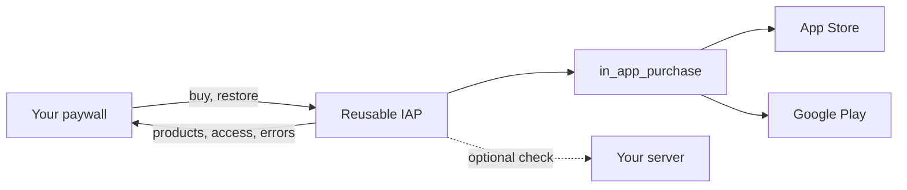

# Reusable IAP

**In-app purchases for Flutter, without the plumbing.** Sell subscriptions, consumables and non-consumables on the App Store and Google Play through one small API.

[](https://flutter.dev)
[](https://pub.dev/packages/in_app_purchase)

[](LICENSE)

Calling `buy()` is the easy part. Then Google Play refunds a sale because nobody acknowledged it. One subscription comes back as several products. A payment finishes while your app is closed, and lands on a launch you weren't expecting.

`reusable_iap` is the code every app ends up writing around Flutter's official [`in_app_purchase`](https://pub.dev/packages/in_app_purchase) plugin, written once and tested. You keep your own paywall, your own state management and, if you have one, your own backend. Nobody sits between you and the stores.



## The traps it saves you from

| The trap | What happens | What Reusable IAP does |
|---|---|---|
| A purchase never gets completed | Google Play refunds it after three days. The App Store sends it again on every launch | Completes it for you, once your check passes |
| One subscription, many entries | Play returns one product per base plan and offer, so a paywall can list the same plan several times | One entry per product ID |
| Errors come from everywhere | A purchase can throw, return `false`, or report later on a stream | One `error`, with a code you can switch on |
| Purchases arrive when they like | A payment can land at launch, long after the buy button was tapped | One stream of state, whenever it happens |
| Product IDs spread through your screens | A new yearly plan means editing every `if (id == 'pro_monthly')` | Screens ask about `premium`, and one function maps IDs to it |
| Tests need a real store | Every test needs a device and a test account | Swap in a fake `BillingGateway` and run anywhere |

## What it is, and what it isn't

| It is | It isn't |
|---|---|
| A headless layer over the official plugin | A paywall, or any UI at all |
| One stream of state: products, loading, errors, what the user owns | A hosted service like RevenueCat: no dashboard, no charts, no sign-up, no fee |
| The purchase lifecycle done for you: pending, restore, completing | A server. It can call yours, but it doesn't come with one |
| Products mapped to access, so `pro_monthly` and `lifetime` can both mean `premium` | Storage. Access lives in memory, so you save it between launches |
| A report of every purchase, with a check before access is granted | A wallet. It tells you coins were bought, and you count them |

It also isn't a way to take card payments or sell physical goods.

## Should you use it?

**Use it if** you sell from a Flutter app on the App Store and Google Play, want no one between you and the stores, and either have your own backend or are selling something low-stakes like removing ads.

**Skip it if** you:

- want renewal tracking across devices, charts and hosted paywalls without running a server. Use [RevenueCat](https://www.revenuecat.com/).
- need several plans under one product, promotional offers or upgrade paths. Use `in_app_purchase` directly.
- sell physical goods or anything used outside the app. Stores don't allow in-app purchases for those. Use a payment provider like Stripe.

Read more: [in_app_purchase vs RevenueCat](https://bimalkhatri.com.np/blogs/in-app-purchase-vs-revenuecat), the same game built on both, and what each costs at different sizes.

## Quick start

```yaml
dependencies:
  reusable_iap:
    git:
      url: https://github.com/yhh-it-solutions/reusable_iap.git
```

That's the only billing package you add. It brings `in_app_purchase` with it.

```dart
final iap = IapService(
  config: IapConfig(
    products: {
      const IapProductDefinition.subscription('pro_monthly'),
      const IapProductDefinition.nonConsumable('lifetime'),
      const IapProductDefinition.consumable('coins_100'),
    },
  ),
  // Which access each purchase gives.
  entitlementResolver: (purchase) => switch (purchase.productId) {
    'pro_monthly' || 'lifetime' => {'premium'},
    _ => const <String>{},
  },
);

iap.state.listen((state) {
  // Draw your paywall from state.products, state.loading and state.error.
  final isPremium = state.activeEntitlements.contains('premium');
});

await iap.initialize();      // As early as you can, at app start.
await iap.loadProducts();
await iap.buy('pro_monthly');
await iap.restore();         // Behind a "Restore Purchases" button.
```

Next: [using the package](doc/using_the_package.md), from catalog to errors and testing.

## What you can sell

| Type | What it is | Example | Who remembers it |
|---|---|---|---|
| Consumable | Used up, and can be bought again | 100 coins | You |
| Non-consumable | Bought once, kept forever | Lifetime unlock | The store |
| Subscription | Renews until cancelled | Pro, monthly | The store |

Read more: [in-app purchases explained](doc/in_app_purchases_explained.md), then [every term for both stores](https://bimalkhatri.com.np/blogs/in-app-purchase-terms-explained).

## Setting up the stores

The code is the small part. Products must exist in both stores first:

| Step | Where | What |
|---|---|---|
| 1. Paperwork | App Store Connect, Play Console | Paid Apps Agreement, tax and bank; payments profile |
| 2. A build | Xcode, Play Console | In-App Purchase capability; a build on a testing track |
| 3. Products | App Store Connect, Play Console | Create them with the same IDs as your code, and activate them |
| 4. Testers | App Store Connect, Play Console | Sandbox accounts; license testers |

Read more: the [store setup guide](doc/store_setup.md) walks through each one.

## Can it work with my own backend?

Yes. Pass `verifyPurchase` and nothing is granted until your server says the purchase is real:

```dart
IapService(
  config: config,
  verifyPurchase: (purchase) => myApi.verify(
    store: purchase.verificationData!.source,
    proof: purchase.verificationData!.serverVerificationData,
    productId: purchase.productId,
  ),
);
```

Without it, the app trusts the store's answer on the device. That's fine for removing ads, but not for coins or paid content.

Read more: [your own backend](doc/your_own_backend.md), then [verifying StoreKit 2 and Google Play purchases on a server](https://bimalkhatri.com.np/blogs/verify-in-app-purchases-server).

## Clean architecture

The [`example/`](example) is a small store in three layers, where only `data/` knows this package exists:

```text
Screen → Cubit → Use cases → StoreRepository ← StoreRepositoryImpl → IapService
```

Screens read `isPremium`, tests run without a store, and swapping billing later means rewriting one folder.

Read more: the [clean architecture guide](doc/clean_architecture.md) builds it step by step, with get_it and injectable too.

## Docs

| Guide | For when you want |
|---|---|
| [In-app purchases explained](doc/in_app_purchases_explained.md) | The concepts and the three product types |
| [Store setup](doc/store_setup.md) | What you need, what to create, and where |
| [Using the package](doc/using_the_package.md) | From catalog to paywall, errors and testing |
| [Clean architecture](doc/clean_architecture.md) | Domain, data and presentation layers, explained on the example |
| [Your own backend](doc/your_own_backend.md) | Verifying purchases on your server |
| [Troubleshooting](doc/troubleshooting.md) | Products not found, refunds, stuck purchases |

## Go deeper

These come from an 18-part series on in-app purchases in Flutter.

**Start here**

- [Flutter In-App Purchases: The Complete 2026 Guide](https://bimalkhatri.com.np/blogs/flutter-in-app-purchases-guide): store setup, server checks, testing and fees, and the map of the series.
- [App Store and Google Play Commission in 2026](https://bimalkhatri.com.np/blogs/app-store-google-play-fees): what each store keeps from a sale.

**Set up the stores**

- [Paid Apps Agreement and Google Play Payments Profile](https://bimalkhatri.com.np/blogs/paid-apps-agreement-google-payments-profile): the paperwork, before any purchase can work.
- [App Store Connect In-App Purchases and Subscription Groups](https://bimalkhatri.com.np/blogs/app-store-connect-in-app-purchases): each product type, field by field.
- [Google Play In-App Products, Base Plans and Subscriptions](https://bimalkhatri.com.np/blogs/google-play-one-time-products-subscriptions): products, base plans and a free-trial offer.

**Test**

- [Add a Sandbox Account on iPhone and Test In-App Purchases](https://bimalkhatri.com.np/blogs/ios-sandbox-testing-in-app-purchases): a StoreKit file, the sandbox and TestFlight.
- [Google Play License Testing](https://bimalkhatri.com.np/blogs/google-play-license-testing): test cards and fast renewals, for free.

**Fix**

- [Flutter In-App Purchase Not Working](https://bimalkhatri.com.np/blogs/flutter-in-app-purchase-not-working): products not found, refunds after three days, purchases replayed on every launch.

## License

[MIT](LICENSE), © 2026 YHH IT Solutions. Use it, change it and ship it, including in paid apps, as long as you keep the license notice.

Built at YHH IT Solutions by Ashish Kunwar and Sudip Paudel. Bimal Khatri supervised the work, improved and optimized the code, and wrote the test cases.
