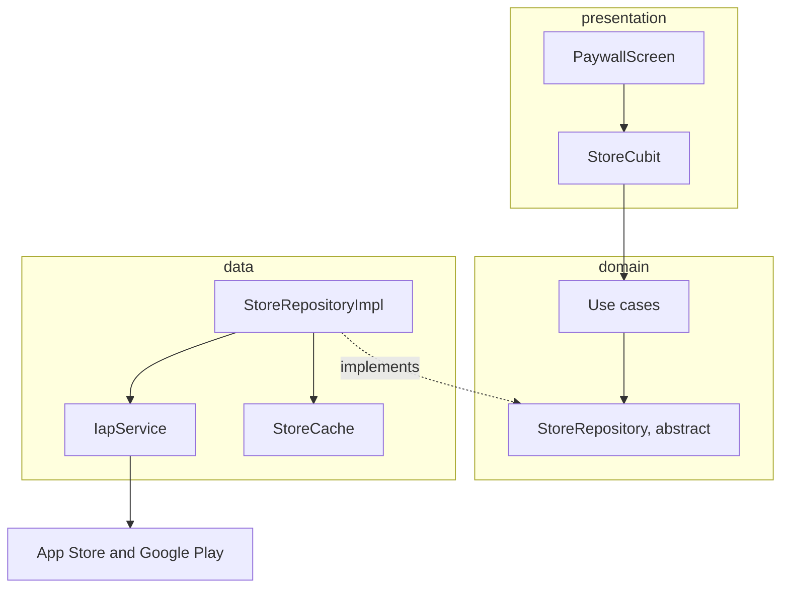

# Clean architecture with Reusable IAP

How to build a store on this package so that one folder knows about it and the rest of your app doesn't. Every code block here is copied from the running [`example/`](../example), whose tests need no store and no device.

## Why wrap it at all

`IapService` is already small, and for a single "remove ads" button you can call it straight from a cubit. Wrap it when the store is more than one button:

- **Your screens stop caring about the store.** They read `isPremium`, while product IDs and store error codes stay in one folder.
- **Tests get easy.** A cubit test uses a fake repository and knows nothing about billing.
- **Changing your mind is cheap.** Move to RevenueCat or your own billing later and you rewrite `data/`. Nothing above it changes.

## The shape



Every arrow points towards `domain`, which depends on nothing else. The folders:

```text
lib/
├── main.dart                         builds everything, once
├── app.dart                          provides the cubit above MaterialApp
└── modules/store/
    ├── domain/                       plain Dart: the app's own words
    │   ├── entity/                   StoreProductEntity, StoreSnapshotEntity, StoreFailure
    │   ├── repository/               StoreRepository, the abstract contract
    │   └── use_case/                 one class per action
    ├── data/                         the only folder that knows reusable_iap
    │   ├── store_catalog.dart        product IDs and what each one grants
    │   ├── store_cache.dart          what must survive a restart
    │   └── repository/               StoreRepositoryImpl
    └── presentation/                 Flutter
        ├── cubit/                    StoreCubit
        ├── views/                    PaywallScreen
        └── widgets/                  AccessCard, ProductTile
```

Three rules hold it together, and [`architecture_test.dart`](../example/test/architecture_test.dart) checks them on every test run:

1. Only `data/` and `main.dart` import `reusable_iap`.
2. `domain/` is plain Dart: no Flutter, no `data/`, no `presentation/`.
3. `presentation/` never imports `data/`.

## Step 1: Domain

Start here, in your app's words, as if the package didn't exist.

**Entities** say what the screen needs to know. Notice there's no `IapState` and no `IapProduct`:

```dart
/// Everything a screen needs to know about the store right now.
class StoreSnapshotEntity extends Equatable {
  const StoreSnapshotEntity({
    this.available = false,
    this.busy = false,
    this.products = const [],
    this.isPremium = false,
    this.coins = 0,
    this.failure,
  });

  final bool available;
  final bool busy;
  final List<StoreProductEntity> products;
  final bool isPremium;
  final int coins;
  final StoreFailure? failure;

  @override
  List<Object?> get props => [
    available,
    busy,
    products,
    isPremium,
    coins,
    failure,
  ];
}
```

Errors get the same treatment: the screen sees `StoreFailure`, never `IapErrorCode`. See [`store_failure.dart`](../example/lib/modules/store/domain/entity/store_failure.dart).

**The repository** is the contract. It's the only thing the upper layers know about the store:

```dart
/// What the app needs from a store. It says nothing about how that's done, so
/// the rest of the app can't tell `reusable_iap` from a fake.
abstract interface class StoreRepository {
  Stream<StoreSnapshotEntity> watch();

  Future<void> start();

  Future<void> buy(String productId);

  Future<void> restore();

  void dispose();
}
```

**Use cases** are one action each. They look thin here, because the store is simple, and that's fine. They give the cubit one clear thing to call, and they're where a rule like "ask the user to log in first" would go:

```dart
class BuyProductUseCase {
  const BuyProductUseCase(this._repository);

  final StoreRepository _repository;

  Future<void> call(String productId) => _repository.buy(productId);
}
```

## Step 2: Data

This is the only layer that talks to the package.

**The catalog** holds every product ID and what each one grants. Adding a yearly plan changes this file and nothing else:

```dart
/// Store product IDs live here and nowhere else.
abstract final class StoreCatalog {
  static const proMonthly = 'pro_monthly';
  static const proYearly = 'pro_yearly';
  static const lifetimeUnlock = 'lifetime_unlock';
  static const coins100 = 'coins_100';

  static const premium = 'premium';
  static const coinsPerPack = 100;

  static IapConfig get config => IapConfig(
    products: {
      const IapProductDefinition.subscription(proMonthly),
      const IapProductDefinition.subscription(proYearly),
      const IapProductDefinition.nonConsumable(lifetimeUnlock),
      const IapProductDefinition.consumable(coins100),
    },
  );

  /// Screens ask about `premium`, so a new plan changes this one line.
  static Set<String> entitlementsFor(IapPurchase purchase) =>
      switch (purchase.productId) {
        proMonthly || proYearly || lifetimeUnlock => const {premium},
        _ => const <String>{},
      };
}
```

**The cache** covers what the package doesn't do. Access lives in memory, so it's saved here to survive a restart and to work offline:

```dart
/// What must survive a restart. The package keeps access in memory only.
class StoreCache {
  const StoreCache(this._prefs);

  static const _isPremiumKey = 'store.is_premium';
  static const _coinsKey = 'store.coins';

  final SharedPreferences _prefs;

  bool get isPremium => _prefs.getBool(_isPremiumKey) ?? false;

  int get coins => _prefs.getInt(_coinsKey) ?? 0;

  Future<void> saveIsPremium(bool value) =>
      _prefs.setBool(_isPremiumKey, value);

  Future<void> saveCoins(int value) => _prefs.setInt(_coinsKey, value);
}
```

**The repository** does the real work, in four parts.

Starting up. Note the early return: "no store on this device" says nothing about what the user owns:

```dart
Future<void> start() async {
  _subscription ??= _iap.state.listen(_onIapState);

  await _iap.initialize();
  // "No store here" says nothing about the user: keep what was saved.
  if (!_iap.currentState.available) return;

  await _iap.loadProducts();
  await _checkAccess();
}
```

Checking access on each launch. This is how a refunded or expired subscription loses access, and how a reinstall gets it back:

```dart
/// Access lives in memory, so each launch asks the store again. That's how an
/// expired or refunded subscription loses access.
Future<void> _checkAccess() async {
  await _iap.restore();

  // restore() returns once the request is sent. Purchases arrive just after.
  await Future<void>.delayed(_restoreSettleTime);

  // "Couldn't ask" is not "doesn't own it": keep what was saved.
  if (_iap.currentState.error != null) return;

  await _cache.saveIsPremium(_iap.hasEntitlement(StoreCatalog.premium));
  _publish(_iap.currentState);
}
```

Reacting to every change. Subscriptions and lifetime unlocks come through entitlements, and the store remembers those. Nobody remembers coins, so you count them, once each:

```dart
void _onIapState(IapState state) {
  _deliverCoins(state.lastPurchase);
  if (state.activeEntitlements.contains(StoreCatalog.premium)) {
    unawaited(_cache.saveIsPremium(true));
  }
  _publish(state);
}
```

```dart
/// `lastPurchase` repeats on every later state, and a store can send the same
/// purchase twice, so each one is counted once.
///
/// A local balance suits a demo. Coins worth real money belong on your server.
void _deliverCoins(IapPurchase? purchase) {
  if (purchase == null ||
      purchase.status != IapPurchaseStatus.purchased ||
      purchase.productId != StoreCatalog.coins100) {
    return;
  }

  // Play's order ID can be missing; its purchase token is always there.
  final orderId = purchase.purchaseId;
  final key = orderId == null || orderId.isEmpty
      ? purchase.verificationData?.serverVerificationData
      : orderId;
  if (key == null || !_deliveredPurchases.add(key)) return;

  unawaited(_cache.saveCoins(_cache.coins + StoreCatalog.coinsPerPack));
}
```

Translating. This is where package types stop. Above this line, they don't exist:

```dart
StoreFailure? _toFailure(IapErrorCode? code) => switch (code) {
  // Closing the payment sheet isn't a failure.
  null || IapErrorCode.purchaseCancelled => null,
  IapErrorCode.storeUnavailable => StoreFailure.unavailable,
  IapErrorCode.emptyCatalog ||
  IapErrorCode.productsNotFound ||
  IapErrorCode.unknownProduct => StoreFailure.itemMissing,
  IapErrorCode.productQueryFailed => StoreFailure.noConnection,
  IapErrorCode.purchaseFailed ||
  IapErrorCode.purchaseStreamFailed => StoreFailure.purchaseFailed,
  IapErrorCode.verificationFailed => StoreFailure.notConfirmed,
  IapErrorCode.purchaseCompletionFailed => StoreFailure.stillFinishing,
  IapErrorCode.restoreFailed => StoreFailure.restoreFailed,
};
```

## Step 3: Presentation

**The cubit** holds no store logic. It follows the repository and passes actions down:

```dart
class StoreCubit extends Cubit<StoreSnapshotEntity> {
  StoreCubit({
    required WatchStoreUseCase watchStore,
    required StartStoreUseCase startStore,
    required BuyProductUseCase buyProduct,
    required RestorePurchasesUseCase restorePurchases,
  }) : _watchStore = watchStore,
       _startStore = startStore,
       _buyProduct = buyProduct,
       _restorePurchases = restorePurchases,
       super(const StoreSnapshotEntity(busy: true));

  final WatchStoreUseCase _watchStore;
  final StartStoreUseCase _startStore;
  final BuyProductUseCase _buyProduct;
  final RestorePurchasesUseCase _restorePurchases;

  StreamSubscription<StoreSnapshotEntity>? _subscription;

  Future<void> load() async {
    _subscription ??= _watchStore().listen(emit);
    await _startStore();
  }

  Future<void> buy(String productId) => _buyProduct(productId);

  Future<void> restore() => _restorePurchases();

  @override
  Future<void> close() async {
    await _subscription?.cancel();
    return super.close();
  }
}
```

**The screen** draws from state. A `BlocListener` turns failures into messages, and the words live in [`store_strings.dart`](../example/lib/modules/store/presentation/store_strings.dart):

```dart
class PaywallScreen extends StatelessWidget {
  const PaywallScreen({super.key});

  @override
  Widget build(BuildContext context) {
    return BlocListener<StoreCubit, StoreSnapshotEntity>(
      listenWhen: (previous, current) =>
          current.failure != null && previous.failure != current.failure,
      listener: (context, state) {
        ScaffoldMessenger.of(context).showSnackBar(
          SnackBar(content: Text(StoreStrings.failure(state.failure!))),
        );
      },
      child: const PaywallView(),
    );
  }
}
```

Three things every paywall needs, all in [`paywall_screen.dart`](../example/lib/modules/store/presentation/views/paywall_screen.dart):

- `product.price` from the store, never a hard-coded price.
- A Restore button. Apple can reject an app without one.
- Disabled buttons while `busy`.

## Step 4: Wire it up

Everything is built once, at the top:

```dart
/// Everything is built once, here. It's the one place outside `data/` that
/// knows `reusable_iap` exists.
Future<void> main() async {
  WidgetsFlutterBinding.ensureInitialized();

  final repository = StoreRepositoryImpl(
    iap: IapService(
      config: StoreCatalog.config,
      entitlementResolver: StoreCatalog.entitlementsFor,
      // With a backend, add: verifyPurchase: myApi.verify,
    ),
    cache: StoreCache(await SharedPreferences.getInstance()),
  );

  runApp(ExampleApp(repository: repository));
}
```

The cubit sits above `MaterialApp` and isn't lazy. This matters more than it looks. A payment can finish while the app is closed, and the store delivers it as soon as you listen. Start listening only when the paywall opens, and someone who already paid keeps seeing ads until they happen to open it:

```dart
return BlocProvider(
  // Above MaterialApp and not lazy: a purchase can land at any moment, so
  // the store has to be listening before any paywall opens.
  lazy: false,
  create: (_) => StoreCubit(
    watchStore: WatchStoreUseCase(repository),
    startStore: StartStoreUseCase(repository),
    buyProduct: BuyProductUseCase(repository),
    restorePurchases: RestorePurchasesUseCase(repository),
  )..load(),
  child: MaterialApp(
    title: 'Reusable IAP Example',
    theme: ThemeData(
      colorScheme: ColorScheme.fromSeed(seedColor: Colors.teal),
    ),
    home: const PaywallScreen(),
  ),
);
```

### With get_it and injectable

The layers don't change, only who builds them. Register the package in a module:

```dart
@module
abstract class StoreModule {
  @lazySingleton
  IapServiceApi get iap => IapService(
    config: StoreCatalog.config,
    entitlementResolver: StoreCatalog.entitlementsFor,
  );

  @preResolve
  Future<SharedPreferences> get prefs => SharedPreferences.getInstance();
}
```

Then annotate each class:

```dart
@lazySingleton
class StoreCache { /* ... */ }

@LazySingleton(as: StoreRepository)
class StoreRepositoryImpl implements StoreRepository { /* ... */ }

@injectable
class BuyProductUseCase { /* ... */ }

@injectable
class StoreCubit extends Cubit<StoreSnapshotEntity> { /* ... */ }
```

Mark `restoreSettleTime` in the repository's constructor with `@ignoreParam`, so the generator leaves its default alone. Provide the cubit as before: `BlocProvider(lazy: false, create: (_) => getIt<StoreCubit>()..load())`.

## Step 5: Test it

Each layer gets the fake that suits it, so nothing needs a store:

| Testing | Fake | What it proves | File |
|---|---|---|---|
| Repository | `BillingGateway` | The launch check, coin counting, failure mapping | [`store_repository_impl_test.dart`](../example/test/store_repository_impl_test.dart) |
| Cubit | `StoreRepository` | It follows the store and passes actions down | [`store_cubit_test.dart`](../example/test/store_cubit_test.dart) |
| Screen | `StoreRepository` | Prices show, Buy buys, busy disables | [`paywall_screen_test.dart`](../example/test/paywall_screen_test.dart) |
| Layers | None | The three rules above | [`architecture_test.dart`](../example/test/architecture_test.dart) |

The repository test runs the real `IapService` on a fake store, so it covers your code and the package together:

```dart
test('turns premium off when the store no longer has it', () async {
  await build(saved: {'store.is_premium': true});

  await startAndSettle();

  expect(snapshots.last.isPremium, isFalse);
  expect(cache.isPremium, isFalse);
});
```

Real purchases still need a real device and test accounts. See [store setup](store_setup.md).

## Recipes

**Add a product.** Create it in both stores, add its ID and type to `StoreCatalog`, and map it in `entitlementsFor` if it grants access. No screen changes.

**Add your own backend.** Put the call in `data/` and pass it in `main.dart`. Nothing else moves:

```dart
class StoreApi {
  StoreApi(this._client, this._verifyUrl);

  final http.Client _client;
  final Uri _verifyUrl;

  Future<bool> verify(IapPurchase purchase) async {
    final data = purchase.verificationData!;
    final response = await _client.post(
      _verifyUrl,
      headers: {'content-type': 'application/json'},
      body: jsonEncode({
        'store': data.source,
        'proof': data.serverVerificationData,
        'productId': purchase.productId,
      }),
    );
    return response.statusCode == 200;
  }
}
```

```dart
IapService(
  config: StoreCatalog.config,
  entitlementResolver: StoreCatalog.entitlementsFor,
  verifyPurchase: StoreApi(http.Client(), verifyUrl).verify,
);
```

Now the server credits coins, so `_deliverCoins` goes away and the balance comes from your API. See [your own backend](your_own_backend.md) for what the server does.

**Sell one thing.** For a single "remove ads" subscription, keep the same layers and drop `coins`, `_deliverCoins` and the extra products.

**Use something other than Cubit.** Only `presentation/` changes. A Riverpod notifier or a `ChangeNotifier` calls the same use cases and listens to the same stream.

## Mistakes to avoid

| Mistake | What goes wrong | Do this instead |
|---|---|---|
| Creating `IapService` in the paywall | Purchases aren't seen until it opens | Build it once at startup, and call `load()` from a non-lazy provider |
| Creating two `IapService`s | Each one handles every purchase, so your check runs twice | Keep one, in `main.dart` or a singleton |
| Saving `false` when the store can't answer | A subscriber gets ads on a plane | Change the saved value only after a clean restore |
| Skipping the wait after `restore()` | A subscriber reads as "not subscribed" | Purchases arrive after it returns, so give them a moment |
| Adding coins on every state | Balances grow on their own, because `lastPurchase` repeats | Count each purchase ID once |
| Awaiting `buy()` for the result | It returns once the request is sent, not when the payment ends | Read the result from state |
| Trusting the device for coins | Modified apps can fake a purchase | [Verify on a server](your_own_backend.md) |

## Read more

- [Flutter in_app_purchase Tutorial: Coins and Subscriptions](https://bimalkhatri.com.np/blogs/flutter-in-app-purchase-tutorial): the same kind of store built with the same layers, directly on the plugin, so you can see what this package takes care of.
- [in_app_purchase vs RevenueCat: Which to Use in Flutter](https://bimalkhatri.com.np/blogs/in-app-purchase-vs-revenuecat): what the data layer looks like on each, and why swapping it is cheap.
