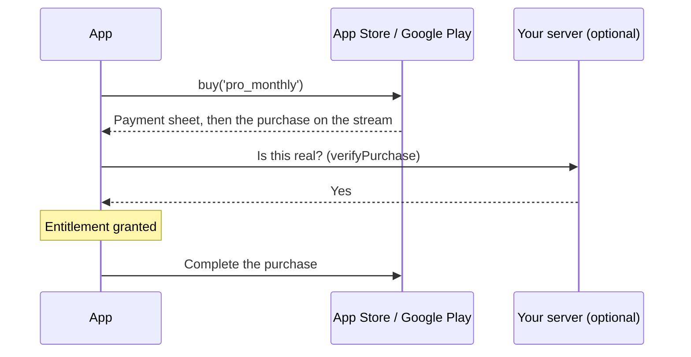

# In-app purchases explained

## What an in-app purchase is

A digital item sold inside your app, paid for through the App Store or Google Play. The store shows the payment sheet, takes the money, handles tax and refunds, and tells your app what happened. Your app never sees a card number.

## What it isn't

- **A payment gateway.** You can't charge cards with it, and you can't set any price you like: the stores have their own price lists and take a commission.
- **For physical goods.** Apple requires other payment methods for physical goods and for services used outside the app. If you sell food, tickets or taxi rides, use a provider like Stripe.
- **Optional for digital goods on iOS.** Apple's rules say that unlocking features, game currency, levels or premium content must use in-app purchase, with some regional exceptions.
- **Tied to your user accounts.** A purchase belongs to the Apple or Google account that made it. An iPhone purchase means nothing on Android unless your own backend links the two.

## The three product types

| | Consumable | Non-consumable | Subscription |
|---|---|---|---|
| **What it is** | Used up, then bought again | Paid once, kept for good | Charged every period until cancelled |
| **Examples** | Coins, hints, extra lives | Lifetime unlock, a level pack | Monthly Pro, ad-free plan |
| **Restored on a new device?** | No | Yes | Yes, while active |
| **Who tracks it?** | You: keep the balance yourself | The store | The store handles renewals |
| **In this package** | `IapProductDefinition.consumable` | `.nonConsumable` | `.subscription` |

Two things catch people out:

- **Google has no "consumable" setting.** Play Console only has one-time products. Consuming one in code is what makes it buyable again, which is why you tell this package each product's type.
- **Coins need a home.** Stores don't remember a coin balance. If you keep it only on the phone, it's lost on reinstall and anyone can edit it. A serious economy needs [a backend](your_own_backend.md).

Apple also has a non-renewing subscription, where your app tracks when access ends. This package has no type for it.

## The words you'll meet

| Term | Meaning |
|---|---|
| Product ID | The permanent name your code asks the store for. Apple never lets you reuse one in the same app |
| Entitlement | The access someone holds, like `premium`, whichever product earned it |
| Complete | Telling the store you've delivered. Apple calls it finish, Google calls it acknowledge or consume |
| Restore | Asking the store what this account already owns. Apple expects a Restore Purchases button |
| Pending | Not paid yet: cash at a shop, a slow card, or a parent's approval. Grant nothing until it clears |
| Sandbox / license tester | Test accounts that buy without being charged |

## How one purchase flows

The last step matters. Google refunds a purchase that isn't acknowledged within three days, and Apple keeps delivering an unfinished one on every launch. This package completes purchases for you.

## Read more

- [In-App Purchase Terms: Consumable vs Non-Consumable](https://bimalkhatri.com.np/blogs/in-app-purchase-terms-explained): every term for both stores, including subscription groups, base plans, signed transactions and purchase tokens.
- [App Store and Google Play Commission in 2026](https://bimalkhatri.com.np/blogs/app-store-google-play-fees): what each store keeps from a sale, worked through before taxes.
