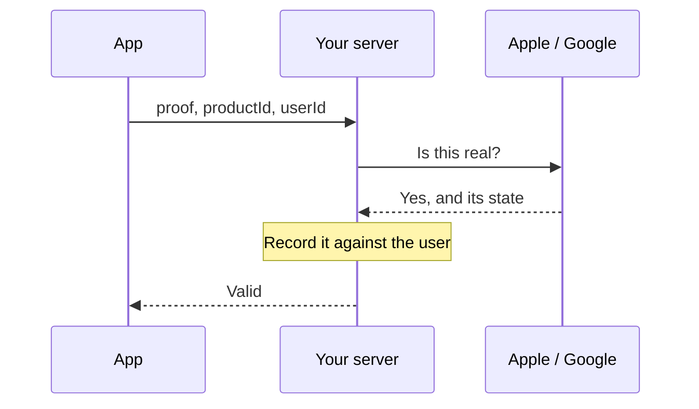

# Your own backend

Yes, `reusable_iap` works with your own server. It doesn't ship one: you pass a function, and that function can call whatever you run.

## Do you need one?

The plugin's own docs prefer server checks, because a phone can be tampered with. Whether it's worth running a server depends on what's at stake:

| You sell | Server? | Why |
|---|---|---|
| Removing ads | Optional | A cheat costs you one user's ad revenue |
| A lifetime unlock in an offline app | Optional | Same: nothing leaves the device |
| Coins or other currency | Yes | Balances on a phone can be edited |
| Paid content or features on your server | Yes | Your server has to know who paid |
| One account across iOS and Android | Yes | The stores don't know about each other |

## How it plugs in

```dart
final iap = IapService(
  config: config,
  entitlementResolver: resolver,
  verifyPurchase: (purchase) async {
    final data = purchase.verificationData!;
    final response = await myApi.post('/purchases/verify', {
      'store': data.source, // 'app_store' or 'google_play'
      'proof': data.serverVerificationData,
      'productId': purchase.productId,
      'userId': currentUser.id,
    });
    return response.isValid;
  },
);
```

| Your function | What the package does |
|---|---|
| Returns `true` | Grants the entitlement, then completes the purchase |
| Returns `false` or throws | Grants nothing, reports `verificationFailed`, and leaves it uncompleted |

Leaving it uncompleted means the store sends it again, so a passing check can still deliver it later. On Google Play it's refunded after three days if it's never completed, so a real purchase must get through by then.

## What your server does



**`proof` from the App Store** is a StoreKit 2 signed transaction (a JWS). Verify its signature with Apple's [App Store Server Library](https://developer.apple.com/documentation/appstoreserverapi) (Node, Python, Java, Swift). Don't send it to the old `verifyReceipt` endpoint: that fails with status 21002.

**`proof` from Google Play** is a purchase token. Look it up through the [Google Play Developer API](https://developers.google.com/android-publisher), signed in as a service account:

- Subscriptions: `purchases.subscriptionsv2.get`. Active, grace period and cancelled-but-not-expired all still grant access.
- One-time products: `purchases.productsv2.getproductpurchasev2`. Grant only when the state is purchased, never pending.

## Rules that keep it safe

1. **Ask the store, never the app.** Anything the device says can be faked.
2. **Record each transaction once**, so one proof can't be replayed for more coins.
3. **Keep balances on the server.** Otherwise the check protects the purchase but not the coins.
4. **Keep your store keys on the server**, and never put them in the app.

## Things to know

- **Android consumables are consumed before your check.** By default the plugin consumes them as they arrive, so a failed check won't bring them back. To hold that step, set `autoConsumeConsumables: false` in `IapConfig` and consume from your server through the Play Developer API.
- **Renewals and refunds happen while the app is closed.** To know about them, subscribe to [App Store Server Notifications](https://developer.apple.com/documentation/appstoreservernotifications) and Google's [Real-time developer notifications](https://developer.android.com/google/play/billing/rtdn-reference). Then your server is the source of truth, and the app should ask it rather than rely on `activeEntitlements`.
- **Send your user's ID yourself**, as above. The package doesn't set the store's account token.

## Read more

- [In-App Purchase Server Verification: StoreKit 2, Google Play](https://bimalkhatri.com.np/blogs/verify-in-app-purchases-server): verifying the StoreKit 2 JWS with Apple's library and asking the Google Play Developer API, then delivering and finishing.
- [Clean architecture](clean_architecture.md#recipes): where the call to your server goes in a layered app.
